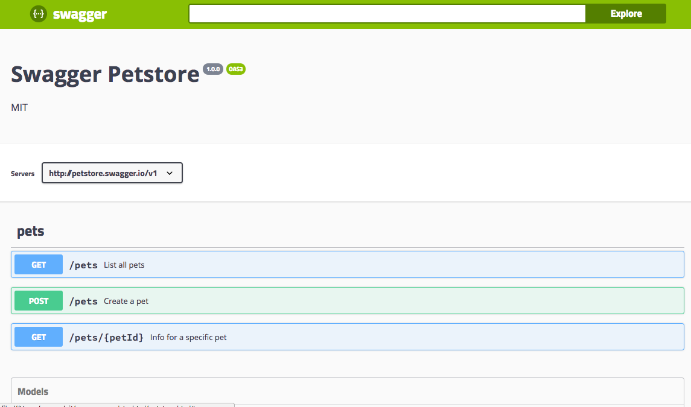

# Swagger YAML into HTML

Converts a Swagger 2.0 / OpenAPI 3.x YAML file into a single, self-contained HTML page
that renders the spec with [Swagger UI](https://github.com/swagger-api/swagger-ui)
(loaded from cdnjs).



# How To Use

## Docker

```
docker run --rm -i yousan/swagger-yaml-to-html < petstore.yaml > petstore.html
```

## Python

Requires Python 3.8+ and PyYAML.

```
pip install -r requirements.txt
python swagger-yaml-to-html.py < petstore.yaml > petstore.html
```

## PHP

Requires PHP 8.1+ with the [yaml](https://pecl.php.net/package/yaml) extension.

```
php swagger-yaml-to-html.php < petstore.yaml > petstore.html
# or
docker build -f Dockerfile-php -t swagger-yaml-to-html-php .
docker run --rm -i swagger-yaml-to-html-php < petstore.yaml > petstore.html
```

`petstore.html` in this repository is the output for `petstore.yaml`.

The PHP version reads YAML through the yaml extension (libyaml) and is tuned to give
the same result as the Python version for normal specs. It stops with an error on
input it cannot read the same way (for example a merge key `<<` that lists an inline
mapping); use the Python version for such files.

# Notes

## "Try it out" sends requests to the wrong host (e.g. `127.0.0.1`)

Swagger UI builds request URLs from `servers` (OpenAPI 3) or `host` / `basePath` / `schemes`
(Swagger 2.0) exactly as written in your YAML. A server URL without a scheme, such as

```yaml
servers:
  - url: 10.28.6.76:8081
```

is not an absolute URL. The browser resolves it against the address of the HTML page
itself (e.g. `http://127.0.0.1/10.28.6.76:8081/...`), or, for a host name with a port
such as `api.example.com:8081`, reads `api.example.com:` as the scheme. Write the full
URL instead:

```yaml
servers:
  - url: http://10.28.6.76:8081
```

The browser also needs to be allowed to call the API (CORS) for "Try it out" to work.

# Tests

```
python -m unittest discover -s tests -v
# against the PHP script
CONVERTER="php swagger-yaml-to-html.php" python -m unittest discover -s tests -v
# against a locally built Docker image
docker build -t swagger-yaml-to-html .
CONVERTER="docker run --rm -i swagger-yaml-to-html" python -m unittest discover -s tests -v
```

# Credits

Based on https://gist.github.com/oseiskar/dbd51a3727fc96dcf5ed189fca491fb3

# Dockerhub

https://hub.docker.com/r/yousan/swagger-yaml-to-html
